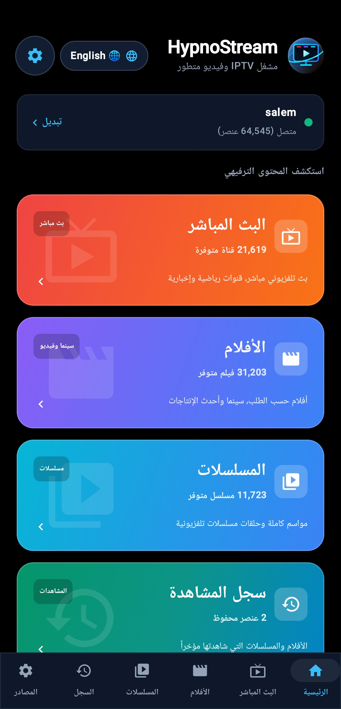
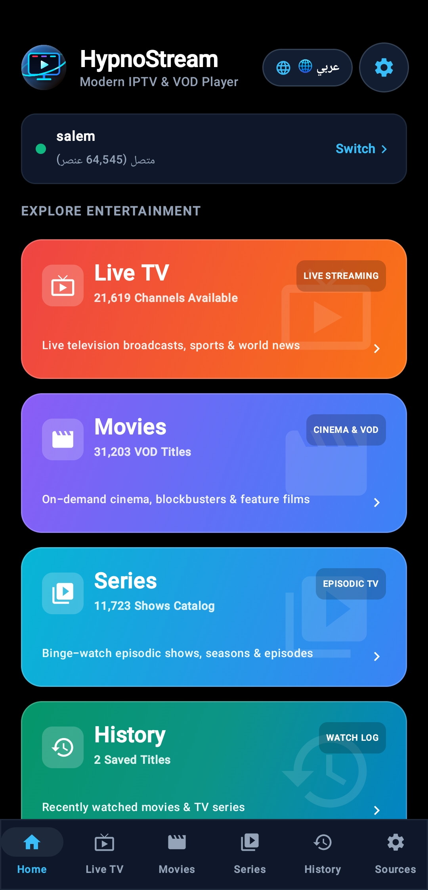
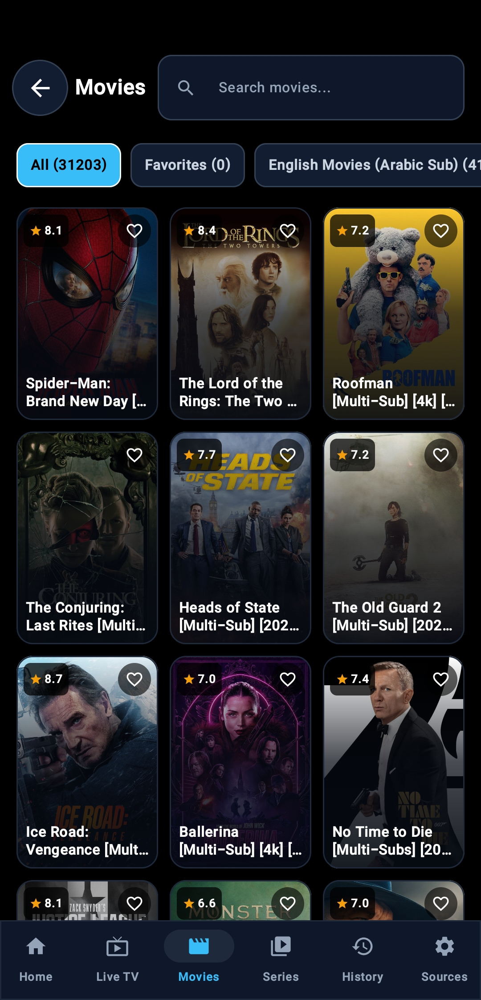
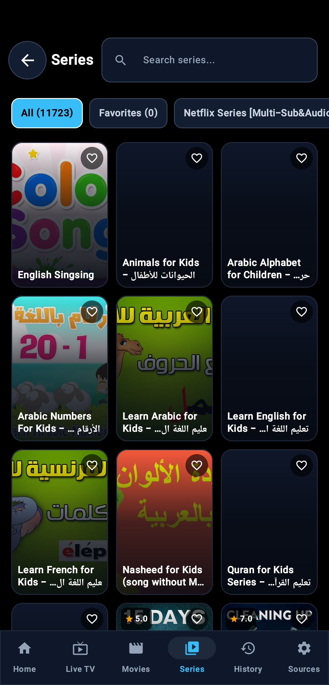
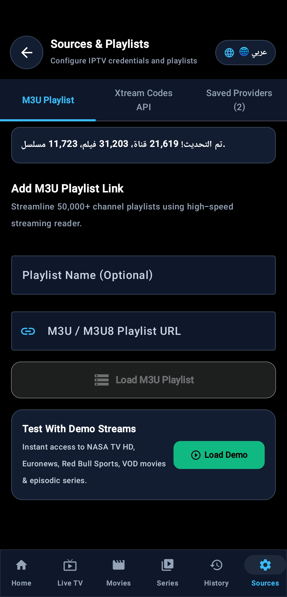
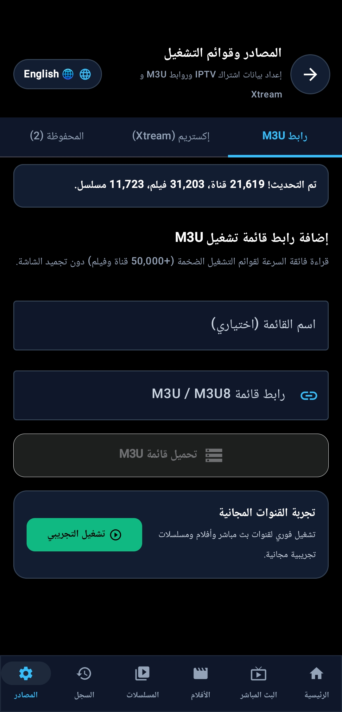

# HypnoStream 📺✨

**HypnoStream** is a modern, high-performance IPTV player engineered for **Android phones, tablets, and Android TV / Google TV**. Designed with an OLED-first electric cyan aesthetic, snappy spring physics, and full D-Pad remote & touch support, it delivers instant channel zapping and seamless VOD binge-watching.

---

## 📸 Screenshots

| | | |
| :---: | :---: | :---: |
|  |  |  |
|  |  |  |

---

## ✨ Key Features

* ⚡ **Instant Startup (Stale-While-Revalidate):** Compresses and caches massive playlists (45,000+ channels, movies, and series) locally via GZIP for instant `< 0.9s` launches while silently syncing server updates in the background, plus a **one-tap Update button** on the dashboard for immediate live reloads.
* 🎬 **True Immersive Cinema Playback:** Built on **AndroidX Media3 / ExoPlayer** with fast-start buffer tuning (`600ms` lock-in), zero-black-screen live channel zapping, automatic reconnection, and full-screen edge-to-edge playback.
* 👆 **Context-Aware Kinetic Gestures & D-Pad Navigation:**
  * **Movies & Series (VOD):** Double-tap left/right for stacking `±10s` skip ripples with haptic feedback, plus automatic resume tracking and a **10-second Binge-Mode Next Episode** countdown.
  * **Live TV:** Double-tap left/right or press `CH+` / `CH-` to instantly zap between channels.
  * **Touch Sliders:** Swipe vertically on the left edge for screen brightness and the right edge for volume.
* 🌐 **10-Language Localization & Dynamic RTL/LTR:** Built-in language selector supporting **English, العربية, 简体中文, 日本語, Français, Español, Türkçe, اردو, Русский, and Português** with automatic RTL/LTR layout mirroring and category translation.
* 🔌 **Dual Playlist Support:** Seamless integration for both **Xtream Codes API** and **M3U / M3U8** playlists with smart auto-detection, favorites management, and watch history tracking.

---

## 🛠️ Tech Stack

* **Language:** Kotlin
* **UI Framework:** Jetpack Compose (Material 3 + Android TV D-Pad Focus Management)
* **Media Engine:** AndroidX Media3 / ExoPlayer
* **Image Loading:** Coil
* **Networking & Caching:** OkHttp + GZIP Local Persistence
